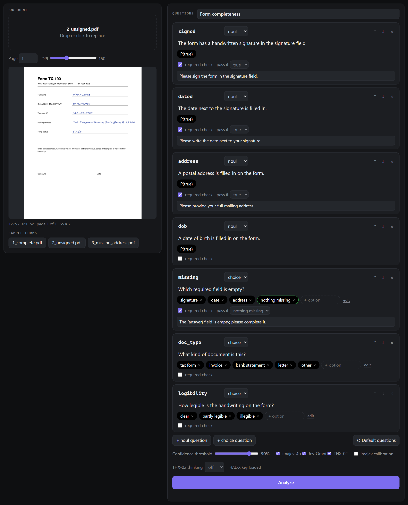
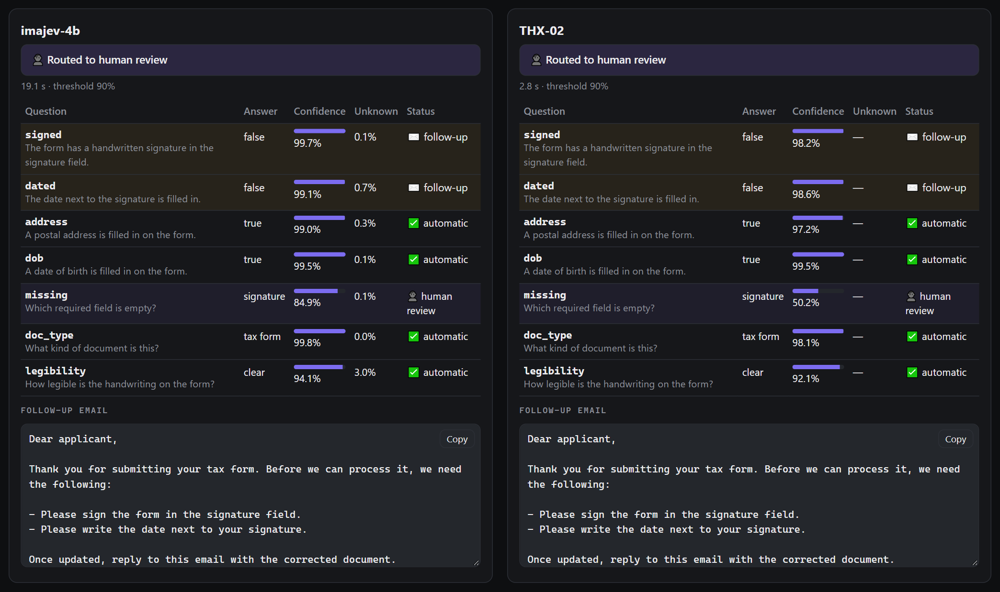

# FormTriage

**Check scanned forms automatically, and know when not to trust the answer.**

FormTriage is a workbench for automating paper-form checks with *vision decision models*. Drop in a PDF or
a photo of a filled-in form, ask it typed questions such as *"Is the form signed?"*, *"Is the date next to the
signature filled in?"* or *"Which required field is empty?"*, and three models answer side by side:
**[imajev-4b](https://huggingface.co/mohit67890/imajev-4b)**, **[Jev-Omni](https://huggingface.co/akhilaaa3/Jev-Omni)**
and **[THX-02](https://huggingface.co/HAL-X-AI/THX-02)**.



### The problem

Back-office teams receive forms all day: tax forms, applications, onboarding and KYC documents, insurance claims,
delivery receipts. Before a form can be processed, someone checks the basics: is it signed and dated, is every
required field filled in, is the handwriting readable, is it even the right document? Most forms are fine and the check
is tedious; the few that are not need a polite email asking the sender to fix them.

The usual automation, OCR plus hand-written rules per form layout, breaks on handwriting, scans and new layouts. A
general chat model can look at the page, but it writes free text and gives no reliable measure of how sure it is, so
you cannot tell which answers are safe to act on.

### The approach

A **decision model** does not write text. It reads the page image together with a question and the options you allow,
and returns a **probability for every option**, in one forward pass. That changes how the automation works:

1. **No OCR, no templates.** The page goes to the model as an image. A new form or a new check is a new question
   written in plain English, not a new template or a retrained model.
2. **Act only when sure.** You pick a confidence threshold (for example 90%). Answers above it are acted on
   automatically; answers below it, or where the model says it cannot tell, send the form to a person.
3. **Answers become actions.** You mark which checks are required and what the passing answer is. A confident failed
   check (no signature, empty address) adds your sentence to a follow-up email, so the sender gets a precise request
   such as *"Please sign the form in the signature field."* The email is assembled from your sentences with plain
   conditional logic; no LLM writes it, so it says exactly what you approved.
4. **Compare before you choose.** The same page and questions go to three different models at once, so you can see
   where they agree, where they differ and how confident each one is before you pick one for production.



*Real output for `samples/2_unsigned.pdf`: both models find the missing signature and date with 98–99.7% confidence,
and both are unsure which single field is "the" empty one (there are two), so the form is routed to human review.*

### What it is, and what it is not

It is a **local web app for designing and evaluating** form checks: tune the questions, the DPI and the threshold on
your own sample forms, and see which decisions could be automated and which still need a person. It is **not** a
production pipeline: it handles one page at a time, keeps no history, and sends page images to third-party model
servers (see [Privacy and limits](#privacy-and-limits)). The decision rules in `app.py` are small and documented, so
they are easy to carry into a real system once you know which model and questions work.

## Contents

- [Features](#features)
- [How it works](#how-it-works)
- [Quick start](#quick-start)
- [API keys](#api-keys)
- [Using the app](#using-the-app)
- [Decision rules](#decision-rules)
- [The models](#the-models)
- [Privacy and limits](#privacy-and-limits)
- [Project structure](#project-structure)
- [HTTP API](#http-api)
- [Tests](#tests)
- [Adding or replacing a model](#adding-or-replacing-a-model)
- [Troubleshooting](#troubleshooting)
- [Credits](#credits)

## Features

- **No OCR.** The page is rendered to an image and sent as is; the models read the pixels, handwriting included.
- **PDF and images.** PDF, PNG, JPG and WebP; pick the page of a multi-page PDF and the resolution (72–300 DPI).
- **Three models side by side**, run in parallel, each with its own verdict, answer table and email.
- **Editable questions**, as cards: yes/no statements (`noul`) or multiple choice (`choice`) with option chips.
- **Required checks.** Mark which answers must pass (`pass if`) and the sentence to send when they do not.
- **Confidence threshold.** Below it an answer is not trusted and the form goes to a person; moving the slider
  re-decides instantly without calling the models again.
- **Follow-up email** assembled from the sentences of the failed checks.
- **THX-02 thinking**: let THX-02 write a short reasoning note before deciding, shown under its answer.
- **imajev calibration**: optionally apply imajev's published temperature calibration.
- Questions are saved in the browser, so they survive a page reload.

## How it works

```
 PDF / image
     │  PyMuPDF renders the chosen page at the chosen DPI
     ▼
 page image (PNG) ──────────────┬───────────────────────┬────────────────────────┐
                                ▼                       ▼                        ▼
                     imajev-4b (HF Space)     Jev-Omni (HF Space)       THX-02 (HAL-X API)
                     all questions at once    one call per question     all questions at once
                                └───────────────────────┼────────────────────────┘
                                                        ▼
                          per question: answer + probability (+ "unknown" for imajev)
                                                        ▼
                     threshold + required checks → status per question → verdict per model
                                                        ▼
                                      follow-up email from the failed checks
```

The server (`app.py`, FastAPI) renders the document, calls the models and applies the decision rules. The page
(`index.html`, plain HTML and JavaScript, no build step) holds the question editor and shows the results.

## Quick start

You need **Python 3.11** (the version it was built and tested with) and an internet connection; the models run on
remote servers, so no GPU is needed.

**Windows (PowerShell)**

```powershell
git clone https://github.com/Cabir22/form-triage.git
cd form-triage
py -3.11 -m venv .venv
.venv\Scripts\pip install -r requirements.txt
copy .env.example .env        # then put your keys in .env (optional, see below)
.venv\Scripts\python app.py
```

**macOS / Linux**

```bash
git clone https://github.com/Cabir22/form-triage.git
cd form-triage
python3.11 -m venv .venv
.venv/bin/pip install -r requirements.txt
cp .env.example .env          # then put your keys in .env (optional, see below)
.venv/bin/python app.py
```

Open **http://127.0.0.1:7860**, click a sample form (`2_unsigned.pdf` is a good first one) and press **Analyze**.
To use another port, set `PORT` before starting (`$env:PORT = "8000"` in PowerShell, `PORT=8000` on macOS/Linux).

## API keys

All keys are optional: without them every model still works on its free tier, with tight limits. Keys live in a file
named **`.env`** in the same folder as `app.py`. Copy `.env.example` to `.env`, fill in what you have and **restart
`app.py`** (the file is read once, at startup):

```ini
# HAL-X THX-02 key, starts with sk-. Without it THX-02 uses the free tier (60 decisions per minute per IP).
HALX_API_KEY=sk-...

# THX-02 endpoint. Leave empty for HAL-X's API, or point it at your own thx02-serve.
HALX_URL=

# Hugging Face token. Raises the ZeroGPU daily quota for imajev-4b and Jev-Omni.
HF_TOKEN=hf_...
```

| Variable | Used by | Where to get it | Without it |
|---|---|---|---|
| `HALX_API_KEY` | THX-02 | your HAL-X contact or the HAL-X console | free tier: 60 decisions per minute per IP |
| `HALX_URL` | THX-02 | only if you [host THX-02 yourself](#running-thx-02-yourself) | `https://api.hal-x.ai/v1/decide` |
| `HF_TOKEN` | imajev-4b, Jev-Omni | https://huggingface.co/settings/tokens (a free "Read" token is enough) | anonymous ZeroGPU quota, a few runs a day |

- Leave a line empty (`HF_TOKEN=`) when you do not have that key; empty values are ignored.
- Variables already set in your shell win over `.env`.
- Under the settings, the page shows **"HAL-X key loaded"** when it found `HALX_API_KEY`, and
  **"HAL-X free tier"** when it did not.
- **Never commit `.env`.** It is listed in `.gitignore`; keys stay on the server and are never sent to the browser.

## Using the app

### 1. Document

Drop a file on the **Document** box or click it to choose one (PDF, PNG, JPG or WebP), or click one of the **sample
forms**. The preview shows exactly the image the models will receive, with its size in pixels and KB.

- **Page**: which page of a multi-page PDF to analyze.
- **DPI**: rendering resolution, 72–300 (default 150). Higher DPI shows small handwriting more clearly but makes the
  image larger; imajev scales images down to about 400,000 pixels anyway, so very high DPI mostly helps THX-02.

### 2. Questions

Each question is a card. The name above the cards (**Form completeness**) is just a label for the set.

| Part of the card | What it does |
|---|---|
| **ID** (bold, top left) | The question's name in the results. Must be unique; click to rename. |
| **Type** (`noul` / `choice`) | `noul` is a statement that is true or false; the models return P(true). `choice` picks one option from a list. |
| **Question text** | What the models read, in English. Write `noul` questions as statements ("The form has a handwritten signature."). |
| **Option chips** (`choice` only) | Click **×** on a chip to remove it, type in **+ option** and press Enter to add one, or click **edit** to change them all at once as `a \| b \| c`. 2–10 options. |
| **required check** | Off: the answer is information only. On: the answer must match **pass if**, otherwise the check fails. |
| **pass if** | The answer that passes: `true`/`false` for `noul`, one of the options for `choice`. The passing chip gets a green border. |
| **Follow-up sentence** | Shown when *required check* is on. Added to the email when the check fails confidently. `{answer}` is replaced with the model's answer, e.g. "The {answer} field is empty; please complete it." |
| **↑ ↓ ×** | Move the card up or down, or delete it. |

Below the cards: **+ noul question**, **+ choice question** (at most 8 questions, imajev's limit) and
**↺ Default questions** to restore the default set.

All required checks start **off**, so a fresh run only reports what the models see. Tick the checks that matter for
your process to get follow-up emails.

The default set:

| ID | Type | Question | Options |
|---|---|---|---|
| `signed` | noul | The form has a handwritten signature in the signature field. | |
| `dated` | noul | The date next to the signature is filled in. | |
| `address` | noul | A postal address is filled in on the form. | |
| `dob` | noul | A date of birth is filled in on the form. | |
| `missing` | choice | Which required field is empty? | signature, date, address, nothing missing |
| `doc_type` | choice | What kind of document is this? | tax form, invoice, bank statement, letter, other |
| `legibility` | choice | How legible is the handwriting on the form? | clear, partly legible, illegible |

### 3. Settings

- **Confidence threshold** (50–99%, default 90%): answers below it are not trusted (see [Decision rules](#decision-rules)).
- **Models**: tick the models to run. Unticked models are skipped and do not use any quota.
- **imajev calibration**: applies imajev's temperature calibration (T = 1.305). It never changes an answer, only how
  confident it looks; the model card advises leaving it off for mostly photo-versus-record checks.
- **THX-02 thinking**: THX-02 can write a short note (the facts or the calculation that decide the question) before it
  answers, then read the question again with the note and mix both reads, so a wrong note cannot overturn a confident
  direct answer.
  - `off`: direct answer, fastest.
  - `auto`: thinks only when the direct answer is unsure (top probability below 0.6) *and* THX-02's own gate says the
    question needs step-by-step work; note of up to 96 tokens; final answer = 70% direct + 30% after thinking.
  - `on`: thinks on almost every question (below 0.97), note of up to 320 tokens, 50/50 mix; 0.5–2 s more.

  Thoughts are shown in *italics* under the answer. They are working notes for the model and can contain mistakes.
  For simple "is it filled in?" checks `off` is usually enough; `auto` helps when a question involves dates, numbers or
  rules ("is the applicant over 18?").

### 4. Analyze and read the results

Press **Analyze**. THX-02 answers in a few seconds; the Hugging Face models can take from 10 seconds to a minute while
a GPU is assigned. Each model gets a panel with:

- a **verdict**: ✅ approved automatically, ✉️ follow-up email needed, or 👤 routed to human review;
- a row per question: the **answer**, its **confidence** (hover the answer to see every option's probability),
  imajev's **unknown** probability, and the **status**;
- the **follow-up email**, with a **Copy** button, when a required check failed.

Change the threshold or the questions' *required* settings after a run and the panels update immediately, without
calling the models again. Renaming or adding a question marks it **↻ run again**.

## Decision rules

Each answer gets one status:

| Status | When |
|---|---|
| 👤 **human review** | The confidence is below the threshold, or imajev abstained ("can't tell"). |
| ✉️ **follow-up** | Confident, *required check* is on, and the answer is not the **pass if** value. Its follow-up sentence goes into the email. |
| ✅ **automatic** | Confident, and either it passes its check or it is information only. |

The model's verdict is the worst status among its questions: any human review → **routed to human review**; otherwise
any follow-up → **follow-up email needed**; otherwise **approved automatically**.

**Confidence** is the probability of the winning answer. For imajev the "unknown" mass counts against it: an answer of
95% with 10% unknown has a confidence of 85.5%.

The email names the document type when the `doc_type` question was answered confidently ("Thank you for submitting your
tax form"), otherwise it says "form". Identical sentences are included once.

## The models

| | imajev-4b | Jev-Omni | THX-02 |
|---|---|---|---|
| Made by | Mohit Garg | akhilaaa3 | HAL-X |
| Weights | [open, Apache-2.0](https://huggingface.co/mohit67890/imajev-4b) | [open, Apache-2.0](https://huggingface.co/akhilaaa3/Jev-Omni) | [open, Apache-2.0](https://huggingface.co/HAL-X-AI/THX-02) |
| Size and base | Qwen3.5-4B + LoRA + decision readout | Gemma 4 12B, merged fine-tune + decision head | 4.5 B decision model + 60 M think adapter |
| Runs here on | [Hugging Face Space](https://huggingface.co/spaces/mohit67890/imajev) (ZeroGPU) | [Hugging Face Space](https://huggingface.co/spaces/akhilaaa3/jev-omni) (ZeroGPU) | HAL-X API (`api.hal-x.ai`) or [your own server](#running-thx-02-yourself) |
| Calls per analysis | 1 (all questions) | 1 per question | 1 (all questions) |
| Extras | "unknown" probability, abstention, optional calibration | | thinking with visible thoughts, 20+ languages |
| Typical time here | 5–40 s (GPU queue) | 2–10 s per question | 2–5 s |
| Key | `HF_TOKEN` | `HF_TOKEN` | `HALX_API_KEY` |

`noul` questions go to imajev and THX-02 as written. Jev-Omni only answers questions with options, so a statement is
sent as "Is this statement true? …" with the options Yes / No, and the answer is mapped back to true / false. Choice
options are sent to THX-02 with the option text as their description.

A few facts from the model cards that matter for forms:

- **imajev-4b** is trained to say *can't tell*: every answer carries an `unknown` probability, and it abstains instead
  of guessing. Its card reports 90.3% on held-out constructed document images.
- **Jev-Omni** returns one probability per option from a classification head; it is the largest of the three and also
  handles audio and video (not used here).
- **THX-02** scores 92.9 on key-information extraction from receipts and forms (CORD + FUNSD) and 72.19 on its card's
  public vision index; its probabilities are trained with a proper scoring rule, so they are meant to be thresholded.
  The card's own advice applies here too: check a few hundred labelled examples from your domain before acting on the
  confidence alone.

Why not run imajev-4b and Jev-Omni locally? They need about 9 GB and 24 GB of GPU memory. If you have such a GPU,
see [Adding or replacing a model](#adding-or-replacing-a-model).

### Running THX-02 yourself

THX-02's weights are public, so you can serve it on your own machine and keep page images in-house. Following its
[model card](https://huggingface.co/HAL-X-AI/THX-02):

```bash
hf download HAL-X-AI/THX-02 --local-dir THX-02 && cd THX-02
pip install -r requirements.txt                    # add requirements-fast.txt for the compiled GPU path
THX_API_KEY=change-me thx02-serve --model . --port 8200
```

Then point this app at it in `.env` and restart `app.py`:

```ini
HALX_URL=http://127.0.0.1:8200/v1/decide
HALX_API_KEY=change-me
```

The server is meant for a GPU; the card also reports CPU use in BF16 (about 7.6 GB of memory and 0.6 s per short text
request on an 8-thread CPU; image requests are slower). Thinking needs a separate vLLM "thinker" server on a GPU;
without it THX-02 ignores `think` and answers directly.

## Privacy and limits

- **The page image leaves your computer.** It is sent to Hugging Face (imajev-4b, Jev-Omni) and to HAL-X (THX-02).
  Do not upload real forms with personal data unless that is acceptable for your use. To keep images in-house, untick
  the Hugging Face models and [run THX-02 yourself](#running-thx-02-yourself).
- **Hugging Face ZeroGPU quota.** Anonymous use gets a very small daily GPU quota. Jev-Omni reserves about 68 seconds of
  quota for *each question*, so a 7-question run needs far more than an anonymous quota; a free token helps a little and
  HF PRO gives 40 minutes a day. When the quota is used up, that model's panel shows the error and the other models
  still report.
- **THX-02 free tier**: 60 decisions per minute per IP; each question is one decision.
- **Limits**: 1–8 questions per run (imajev), 2–10 options per choice question, one page per run.
- The probabilities are model outputs, not guarantees. Choose your threshold on a few hundred of your own labelled
  forms before acting on it.
- Uploaded files are kept in a temporary folder until the operating system cleans it, and are forgotten by the server
  when it restarts.

## Project structure

```
.
├── app.py              FastAPI server: rendering, model calls, decision rules, HTTP API
├── index.html          the page: question editor, settings, result panels (plain HTML + JS)
├── test_app.py         offline checks of the decision logic and the HTTP API
├── samples/            three sample forms: complete, unsigned, missing the address
├── docs/screenshots/   images used in this README
├── requirements.txt    Python dependencies
├── .env.example        template for your keys (copy to .env)
└── .gitignore          keeps .env and .venv out of git
```

## HTTP API

The page talks to the server through a small JSON API, which you can also call yourself:

| Method | Path | Purpose |
|---|---|---|
| GET | `/` | The page |
| GET | `/api/defaults` | Default question set, model list, sample names, whether a HAL-X key is loaded |
| POST | `/api/upload` | Upload a document (multipart field `file`); returns a `file_id` |
| POST | `/api/sample/{name}` | Use a sample form; returns a `file_id` |
| GET | `/api/preview?file_id=…&page=1&dpi=150` | The rendered page as a data URL, with size and page count |
| POST | `/api/run` | Run the models: `{file_id, page, dpi, questions, models, calibrated, think}`; returns raw answers per model |
| POST | `/api/decide` | Apply the rules: `{questions, results, threshold}`; returns verdict, rows and email per model |

`questions` is the list of cards as the page stores them, for example:

```json
{"id": "signed", "type": "noul", "question": "The form has a handwritten signature in the signature field.",
 "required": true, "pass_if": "true", "follow_up": "Please sign the form in the signature field."}
```

FastAPI also serves interactive API docs at http://127.0.0.1:7860/docs.

## Tests

```powershell
.venv\Scripts\python test_app.py
```

It prints `ok` when everything passes. It needs no network or keys: the model calls are replaced with canned answers.
It covers question validation, the decision rules and email, the conversion of each model's answers, `.env` loading,
and the HTTP API end to end on a sample form.

## Adding or replacing a model

Each model is one function in `app.py` that takes the page image and the questions and returns, for every question ID,
the result of `answer({option: probability, ...})`:

```python
def ask_mymodel(png, questions):
    ...  # call the model with the PNG bytes and each q["question"] / q["options"]
    return {q["id"]: answer({"true": 0.97, "false": 0.03}) for q in questions}
```

Then add its name to `MODELS` and to the `calls` dictionary in `run()`. A new panel and checkbox appear automatically.
To run imajev-4b or Jev-Omni on your own GPU, replace the body of `ask_imajev` or `ask_omni` the same way; the
decision rules and the page do not change.

## Troubleshooting

| Problem | Fix |
|---|---|
| "You have exceeded your free ZeroGPU quota" | The Hugging Face daily quota is used up. Add `HF_TOKEN` to `.env`, untick Jev-Omni (the heaviest), or wait for the reset time shown in the error. |
| "HAL-X 401" | The `HALX_API_KEY` in `.env` is wrong or revoked. |
| "HAL-X 403" | The key does not grant THX decisions or the model `thx-02`; ask HAL-X to enable it. |
| "HAL-X 429" | Rate limit. The app retries a few times; on the free tier wait a minute. |
| Page still says "HAL-X free tier" after adding the key | Restart `app.py`; `.env` is read only at startup. Check the line is `HALX_API_KEY=sk-...` with no spaces in the key. |
| "The document is gone (server restarted?)" | Uploads are forgotten on restart; upload the file again. |
| Port 7860 is in use | Start with another port: `$env:PORT = "8000"` then `.venv\Scripts\python app.py`. |
| My question edits disappeared | Questions are stored per browser and per address; a different browser or port starts from the defaults. |

## Credits

- Idea from a YouTube demo of a "Form Decision Inspector": https://www.youtube.com/watch?v=L8YxigQoLaM
- [imajev-4b](https://huggingface.co/mohit67890/imajev-4b) by Mohit Garg, Apache-2.0.
- [Jev-Omni](https://huggingface.co/akhilaaa3/Jev-Omni), Apache-2.0, following Gemma 4.
- [THX-02](https://huggingface.co/HAL-X-AI/THX-02) by HAL-X, Apache-2.0; [API reference](https://api.hal-x.ai/docs/thx-02/).
- [PyMuPDF](https://pymupdf.readthedocs.io/) for rendering, [FastAPI](https://fastapi.tiangolo.com/) for the server,
  [gradio_client](https://www.gradio.app/guides/getting-started-with-the-python-client) for the Hugging Face Spaces.
- The sample forms are fictional ("Form TX-100", "Maria Lopez").

Note on licences: PyMuPDF is licensed under AGPL-3.0 (or a commercial licence from Artifex). If you distribute this
project or offer it as a service, make sure that fits your use.
